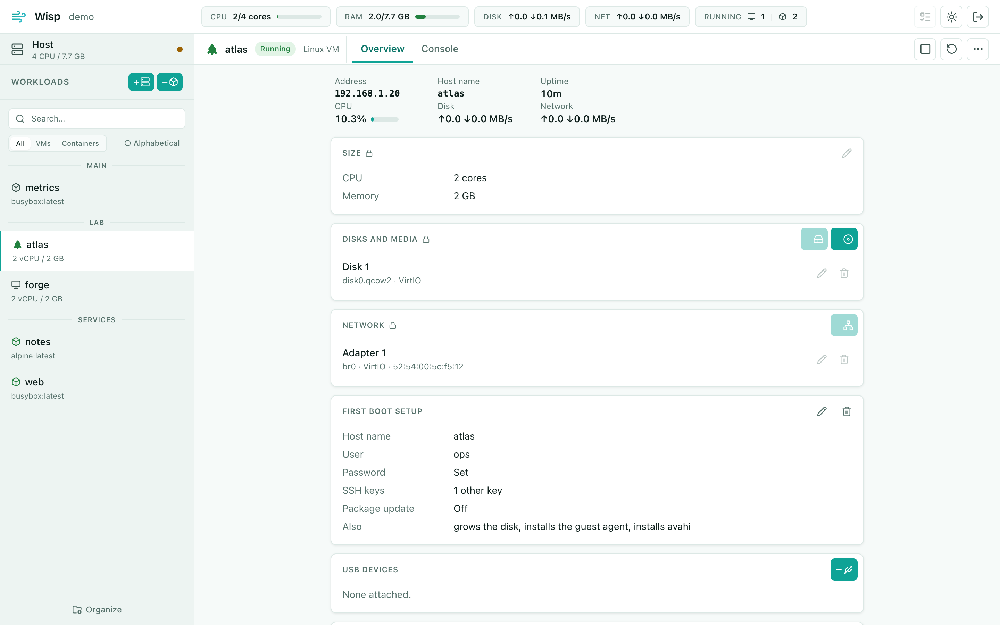
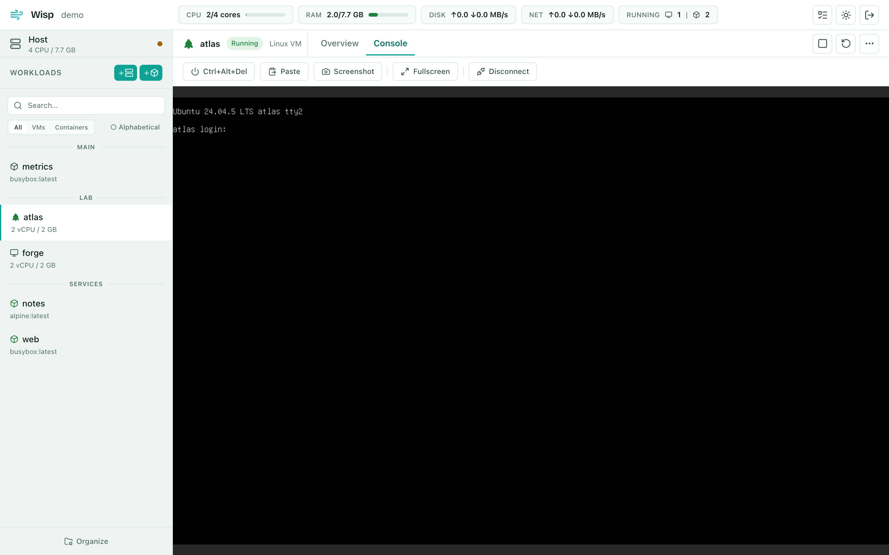
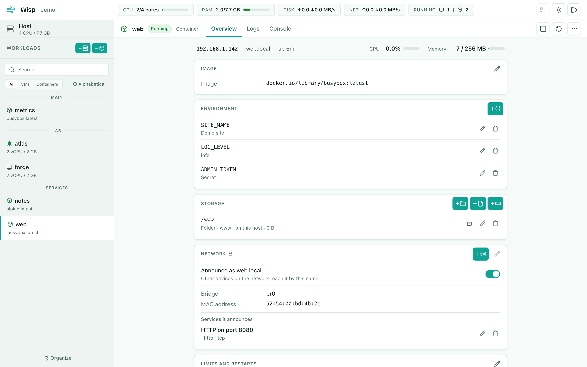
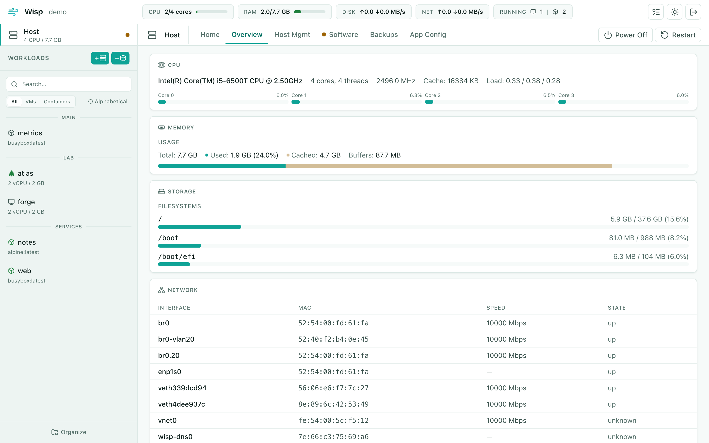
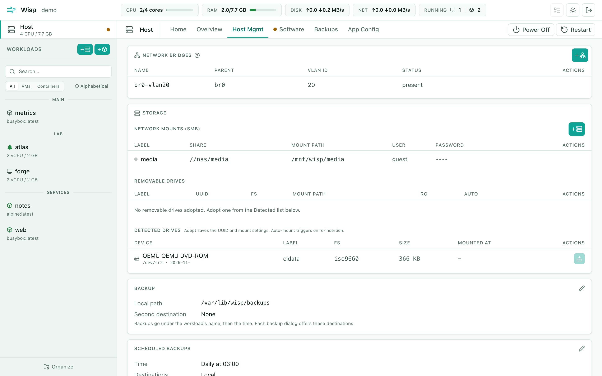
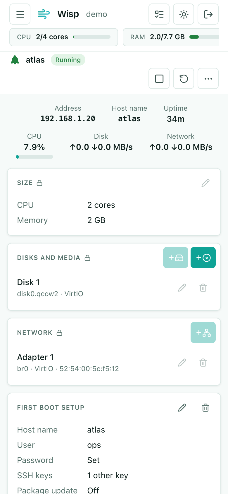
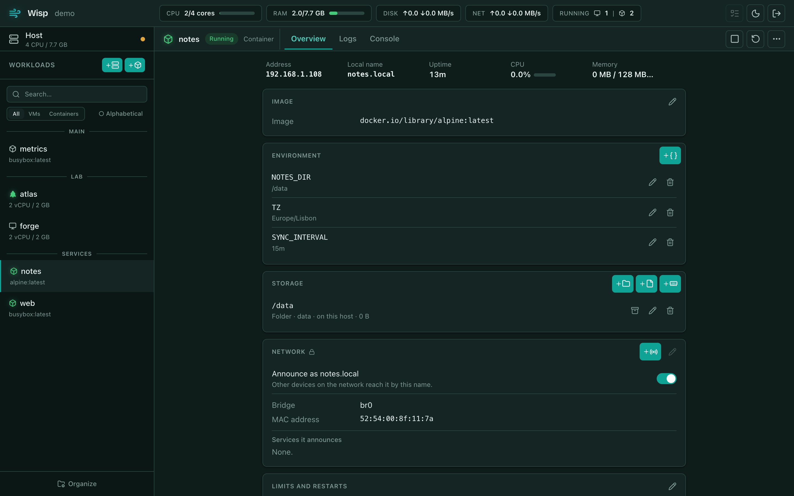

# Wisp

**Wisp** is an **opinionated, single-user** web app for managing **KVM/QEMU virtual machines** and **containerd containers** on one Linux host. It aims to be **simple to use**, with **sensible defaults**: the defaults I wanted for my own homelab, which others may find useful too.

The philosophy: direct flows and clear choices instead of a setting for everything. If you need to tune every knob, Wisp is probably not for you.



## What it does

### Virtual machines

- **A new VM is a short form**: a name, what it runs (a Linux cloud image, a Linux installer, Windows 11, or something else), an image, a size and a disk. Wisp sets the rest from that choice; a Windows 11 VM gets a TPM, and the VirtIO driver disc as its second CD when the library has one.
- **First boot setup** for a Linux cloud image (cloud-init): user, password, SSH keys, host name, package upgrade. SSH keys come from a list Wisp keeps, which can import a GitHub user's keys.
- **Image library** with upload, download from a URL, and one-click downloads of the latest **Ubuntu LTS** and **Arch Linux** cloud images.
- **Console in the browser** (noVNC).
- **USB passthrough**: attach a host device to a running or stopped VM; devices show up as they are plugged in.
- **Edit what makes sense, when it makes sense**: CD-ROMs, USB devices and first boot setup on a running VM; size, disks, network and the expert settings when it is shut off. A change that waits for a restart says so.
- **Expert settings**, out of the way: CPU model, nested virtualization, boot order, video.

### Containers

- **A container is on the network like a VM**: its own LAN address on the host bridge, by DHCP. No NAT, no port mapping.
- **Apps** with their own settings pages: **Caddy** (reverse proxy; a wildcard certificate through the Cloudflare DNS challenge, with a Caddy image that has that module), **Zot** (a local OCI registry), **Jellyfin** (media server), **Tiny Samba** (file shares).
- **Shell in the browser**, and **logs** kept per run.
- **File and folder mounts**, kept with the container or on a storage mount, with an editor in the browser and zip upload. A file mount can be a write-only secret.
- **Environment variables**, with write-only secrets; **CPU and memory limits**; **restart policies**; **start with the host**; an **image update check**.
- **The host's GPU** (Intel or AMD) shared with a container, for transcoding.

### Networking

- Every VM and container sits on the host bridge as a first-class LAN citizen. **VLAN bridges** can be added for workloads that belong on another network.
- **`.local` names**: Wisp publishes each container's name by mDNS, and a container can announce its own services. A VM announces its own name (first boot setup installs avahi in the guest by default). Containers on the main bridge can also resolve `.local` names.
- **Other Wisp hosts** on the LAN show up in the top bar.

### Backups

- **VMs and containers**, to the host's disk and to a second destination on any storage mount (an SMB share or a drive).
- **Containers**: on demand, or nightly with a number of daily and weekly backups to keep. **VMs**: on demand, while shut off.
- **Restore** a VM as a new VM; restore a container as a new one or in place.

### Storage

- **SMB shares and removable drives** as storage mounts: a drive is adopted once and mounts itself when plugged in.

### The host

- **Live figures**: CPU (with P-cores and E-cores), memory, disk and network I/O, temperatures, power draw where the CPU reports it.
- **Hardware inventory**: disks with SMART health, RAM modules, PCI and USB devices. Read from `/proc`, `/sys`, `dmidecode` and `smartctl`, with no agent.
- **OS updates** (apt): checked hourly, installed from the page. **Shut down and restart** from the page.

### Wisp itself

- **Updates itself** from GitHub Releases: checked hourly, installed with one click, rolled back by itself when the new release does not start. Stable and beta channels.
- **Sign-in**: one password, and optionally single sign-on (OIDC).
- **Light and dark themes**, following the system by default. Pages work on a phone, and Wisp can be added to its home screen.
- **Self-contained**: nothing is loaded from a CDN, so the page works with no internet access.

### Agents and automation

- **API tokens** (read-only or admin) for scripts: made in the page, shown once, revocable.
- **MCP endpoint** (`/mcp`), so a coding agent can look at the deployment: every VM and container with its address, a container's `.local` name, a workload's settings (secrets masked), logs, images, live host figures, the hardware inventory.
- **Agent deploys, with guard rails**: with an admin token an agent can deploy a container, update images and start or stop containers. It cannot change a VM. It is a deliberate subset: no deletes, no mounts, no root, and an app's settings are filtered per app (an agent can add a Caddy host, never touch the TLS credentials).

## What it's not

Wisp is not trying to replace anything. If one of these fits your workflow better, use it:

- **[Proxmox](https://www.proxmox.com/)**: if you want control over every detail, clustering, HA or several users.
- **[Docker](https://www.docker.com/) / [docker compose](https://docs.docker.com/compose/) / [Arcane](https://getarcane.app/)**: if you want a Compose workflow or Docker-native tooling. Wisp drives containerd directly and does not speak the Docker API.

Wisp is single-user, single-host, and deliberately scoped. It has no VM snapshots and no clustering.

## Requirements

- **A Linux host** (x86-64): Debian 13, Ubuntu 24.04 or later, or a derivative of either, with systemd 254 or later. Setup refuses any other.
- **The network run by netplan** with the networkd renderer, as on an Ubuntu server install or a cloud image, and a plain Ethernet uplink on DHCP or a static address. Setup makes the bridge (`br0`) that VMs and containers join the LAN through, or uses the one netplan already has on the uplink. It refuses, before it changes anything, a host whose network another tool runs (NetworkManager, systemd-networkd on its own, or ifupdown, which Debian's own installer sets up) and an uplink it cannot bridge, saying what to do.
- **ssh, sudo and `tar`**. Setup installs everything else: QEMU, libvirt, containerd 2, Node.js.
- **KVM** for VMs. A host without it installs and runs containers only.

**Trying it safely**: install Wisp in a dedicated Linux VM with **nested virtualization** turned on, so its guest VMs can still use KVM.

## Installation

1. **Download the latest release tarball** from the [Releases page](https://github.com/acdtrx/wisp/releases/latest): `wisp-X.Y.Z.tar.gz` under *Assets*.

2. **Extract it on the host**:
   ```
   tar -xzf wisp-X.Y.Z.tar.gz
   cd wisp
   ```

3. **Install as your normal user, not root**:
   ```
   ./scripts/install.sh /opt/wisp
   ```

   Before it changes anything it asks for sudo's password, a server name and a Wisp password, and, when the uplink has no bridge yet, for one confirmation that names the interface and the address it will bridge, keeping that address. Then it installs what Wisp needs, makes the bridge and starts Wisp.

Wisp then runs as one systemd service, `wisp.service`, on port **8080** (`WISP_PORT` in `config/runtime.env` changes it). Set a new password with `/opt/wisp/scripts/wispctl.sh password --force`.

Supported hosts, what setup makes and every refusal with its remedy: [`docs/specs/DEPLOYMENT.md`](./docs/specs/DEPLOYMENT.md).

## Updating

Use **Wisp Update** on the Host page's Software tab. The Update button downloads the release, verifies its checksum and installs it; when the new release does not start, the previous one is put back.

**A host on v2.8.0-beta.1 or older** does not update by itself to a later release. Update it once by hand: follow the three installation steps above with the new tarball, over the existing install. Settings, password, VMs and containers stay, and running workloads keep running. From then on it updates by itself.

## Security

Wisp has **full access to libvirt, containerd, the host's storage and the credentials you give it**. Run it only on hosts and networks you trust, and protect the login and the `config/` folder.

- One password per host, stored as a scrypt hash in `config/wisp-password`. Optional single sign-on (OIDC) sits beside it; the password stays as the way back in.
- A session lasts 7 days from its last use.
- API tokens are stored as hashes, and are read-only or admin.

## Documentation

Technical docs live under [`docs/`](./docs/):

- [Architecture](./docs/ARCHITECTURE.md) · [Tech stack](./docs/TECH-STACK.md) · [Coding rules](./docs/CODING-RULES.md) · [Frontend rules](./docs/FRONTEND-RULES.md)
- One contract per subsystem in [`docs/specs/`](./docs/specs/): [the API](./docs/specs/API.md), [deployment](./docs/specs/DEPLOYMENT.md), [updates](./docs/specs/UPDATES.md), VMs, containers, apps, backups, storage, and more.

## Developing

Run the backend and the frontend locally (see `AGENTS.md`), and deploy a build to a Linux host with `./scripts/push.sh user@host /opt/wisp`, which stages the same tarball and runs its installer there. macOS works for development, with no hypervisor behind it.

This project was first built with [Cursor](https://cursor.com) and more recently with [Claude](https://claude.com/claude-code). The codebase has detailed rules (`AGENTS.md`, `docs/`) that work well with AI-assisted editors. If you want a feature that isn't here, **fork it** and point your AI tool of choice at it: the rules will keep it on-pattern.

## Bugs and feedback

Please report bugs and feature requests through **GitHub Issues**.

## License

Wisp is released under the **MIT License**: see [`LICENSE`](./LICENSE).

## Screenshots

**A VM's page**: its settings in groups, live figures at the top.


**A VM's console** in the browser.



**A container's page**: image, environment, storage, network, limits.



**Host overview**: CPU, memory, storage, network and hardware.



**Host management**: bridges, storage mounts, backups.



**On a phone.**



**The dark theme.**


